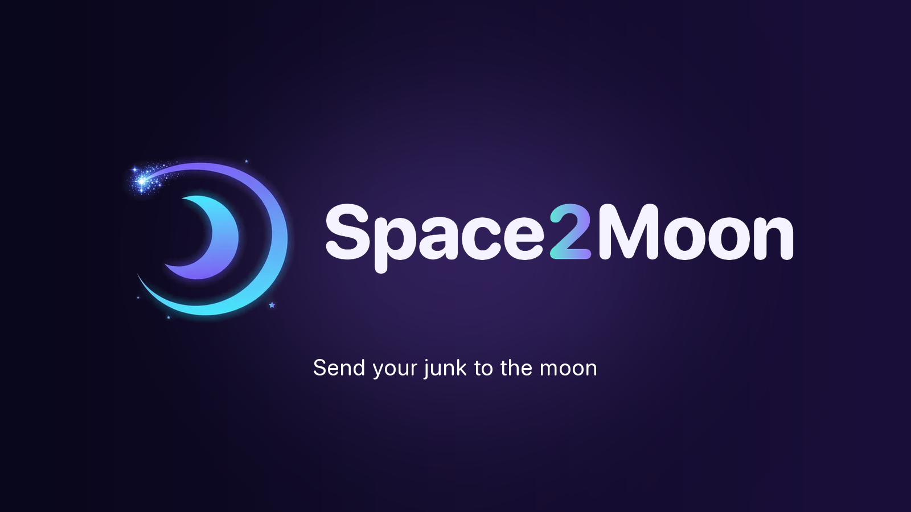
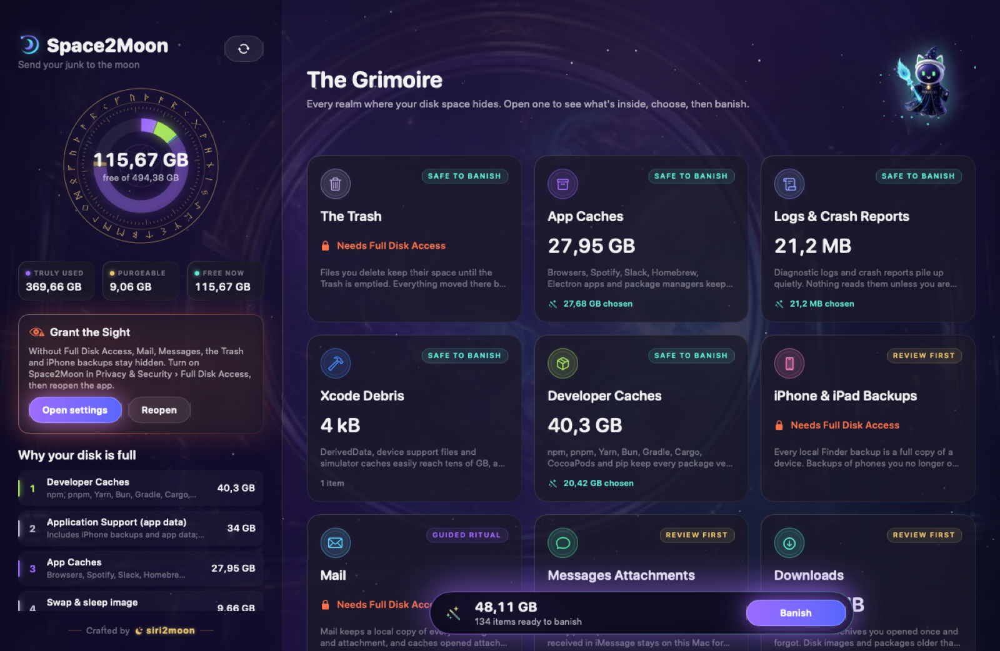
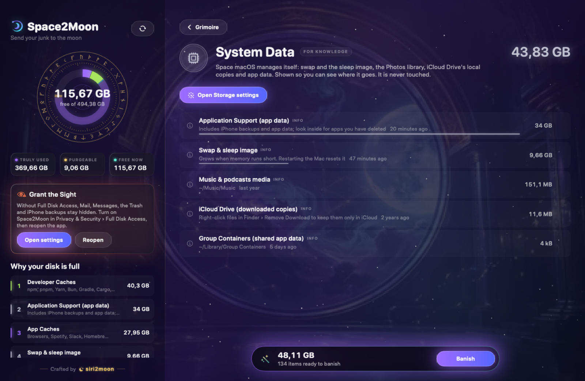

<div align="center">



**Why is my Mac's disk always full? Space2Moon shows you, then gives the space back.**

A free, open-source (MIT) disk cleaner for macOS with a little magic in it.

[Download the latest release](https://github.com/siri2moon/space2moon/releases/latest) · Crafted by [siri2moon](https://siri2moon.com)



</div>

## What it does

- **Divines** every place space hides: the Trash, app caches, logs, Xcode debris, developer caches (npm, pnpm, Yarn, Bun, Gradle, Cargo, CocoaPods, pip…), iPhone and iPad backups, Mail, Messages attachments, Downloads, files over 500 MB, Time Machine local snapshots, Docker and VM disks, and System Data.
- **Explains** what is taking the space in plain words, and what grew since a scan at least 12 hours old, so you can see *why* the disk keeps filling up. History stays on your Mac in `~/Library/Application Support/Space2Moon/history.json`.
- **Banishes** what you choose, and nothing else. Rebuildable data (caches, logs, DerivedData) is deleted; your own files go to the Trash so they can be restored. A safety guard refuses anything outside your home folder, the category folders themselves, and files inside Mail's store or a Photos library.
- **Rituals** for what can't be removed file by file: thin Time Machine snapshots (asks for your password), `docker system prune -a`, remove unavailable simulators, and shortcuts to Mail and Storage settings.

Nothing leaves your Mac. There is no network code, no account and no telemetry.



## Install

1. Download `Space2Moon-<version>.dmg` from [Releases](https://github.com/siri2moon/space2moon/releases/latest), open it and drag **Space2Moon** to **Applications**.
2. The app is not notarized yet, so the first launch needs one extra step: in Finder, **right-click Space2Moon › Open › Open**. (Or run `xattr -dr com.apple.quarantine /Applications/Space2Moon.app` in Terminal.)
3. Grant **Full Disk Access** when the app asks (System Settings › Privacy & Security › Full Disk Access › turn on Space2Moon), then press **Reopen**. Without it, Mail, Messages, the Trash and iPhone backups stay hidden.

Requires macOS 15 or later, on Apple silicon or Intel.

## Build from source

```bash
git clone https://github.com/siri2moon/space2moon.git
cd space2moon
swift test                         # safety guard and oracle tests
./scripts/bundle.sh                # dist/Space2Moon.app
./scripts/bundle.sh --install      # also copy to /Applications
./scripts/release.sh 0.1.0         # universal app + dist/Space2Moon-0.1.0.dmg
```

Local builds are signed ad hoc, so macOS may ask for Full Disk Access again after a rebuild.

## Art

The icon, logo emblem, background and the mascot (Siri, the siri2moon robot, dressed as a wizard) were painted with Meta Muse through [MoonReel](https://github.com/siri2moon/moonreel)'s muse2api:

```bash
./scripts/muse-art.sh                 # paint every missing image into Resources/Art
./scripts/muse-art.sh mage            # repaint one
./scripts/muse-art.sh --pick mage     # use any painting as the app icon
```

It also builds the logo lockups in `Resources/Brand` (`make-logo.py`) and lifts the mascot out of its background with Vision (`cutout.swift`). The app works without any of the art.

## Layout

| Path | What |
|---|---|
| `Sources/MageCore` | Scanner, cleaner, safety guard, history and insights. No UI, runs off the main actor |
| `Sources/Space2Moon` | SwiftUI app: splash, magic circle gauge, grimoire of categories, item lists, banishing |
| `Tests/MageCoreTests` | Swift Testing suites for the safety guard and the oracle |
| `Resources/` | App icon, Muse paintings and logo files |
| `scripts/` | Bundling, release DMG, Muse art, icon, logo and cutout tools |

`SPACE2MOON_SNAPSHOT=/tmp/shot.png` writes PNGs of the window (splash, main view, a category) after the first scan, for checking the UI without screen recording.

## License

[MIT](LICENSE) © siri2moon

## Buy me a coffee ☕

If Space2Moon gave you back a few gigabytes, you can buy me a coffee to keep the magic going.

<a href="https://buymeacoffee.com/siri2moon"></a>


[buymeacoffee.com/siri2moon](https://buymeacoffee.com/siri2moon)
